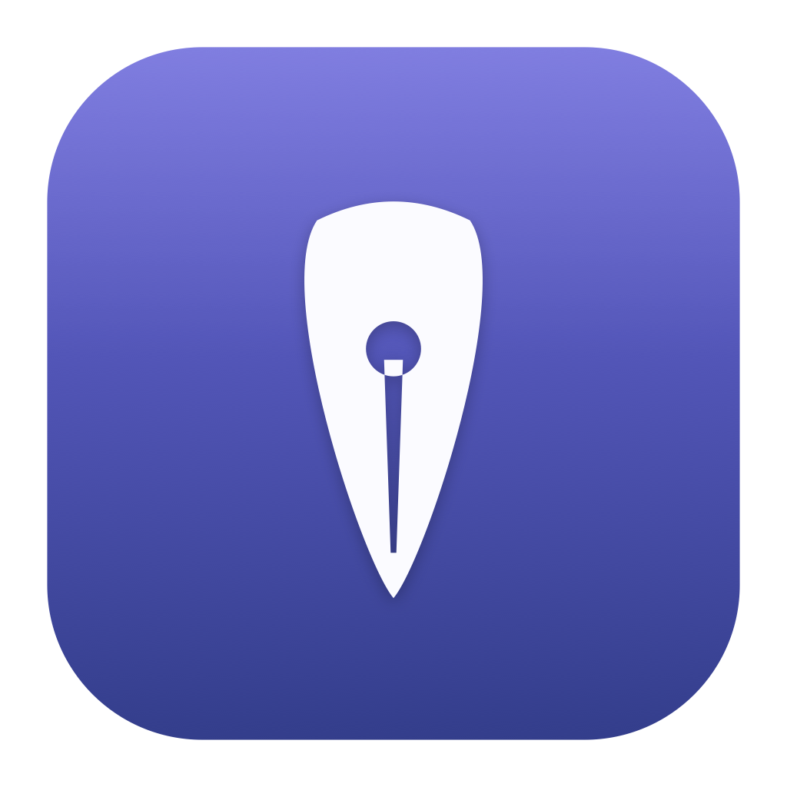
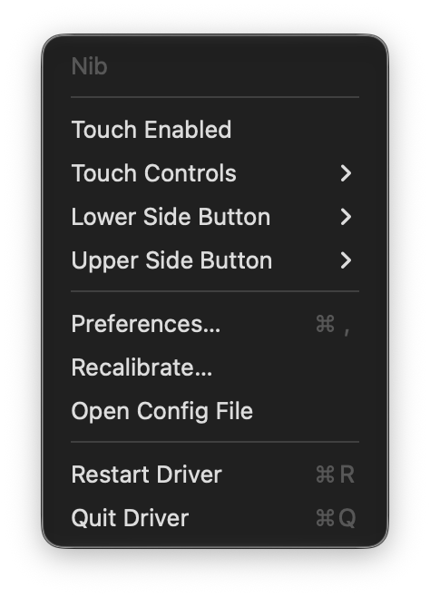
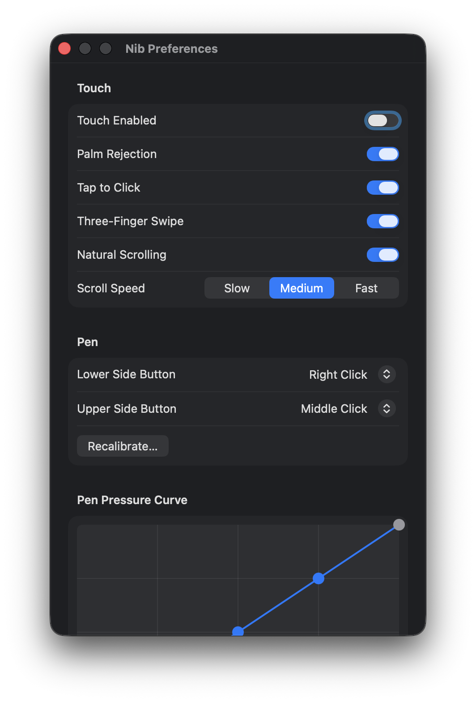
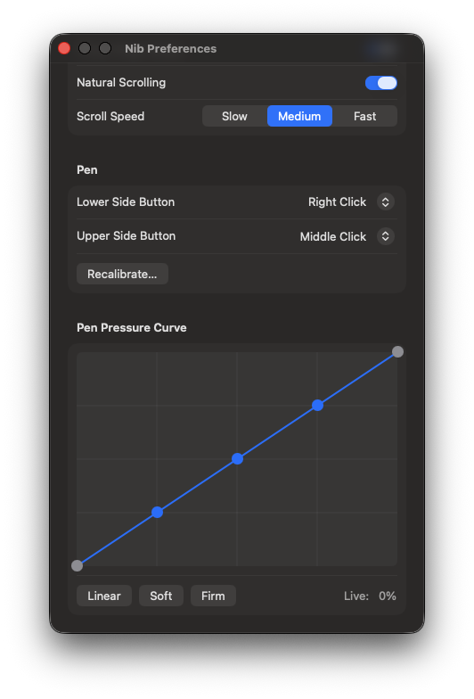

  

# Nib

**Nib** is an independent, open-source macOS driver for the **Cintiq Pro 24 Touch
(model DTH2420)** pen display. It was built from scratch — via clean-room reverse
engineering — because Wacom's drivers frequently break on new macOS releases. This one
was created specifically because the Wacom drivers **do not work on the macOS 27
developer beta**, leaving the tablet unusable. No dependency on OpenTabletDriver or any
vendor software at runtime.

**Working today:** pen (position with in-app calibration, an adjustable pressure curve,
tilt, remappable side buttons), multi-touch (2-finger scroll, tap-to-click, 3-finger
swipe, palm rejection), a menu-bar app and a full preferences window, running as a
persistent per-user LaunchAgent.

## Screenshots

  
  
  

In-app calibration overlay — tap the two crosshairs with the pen:

## Layout
- `driver/` — the Swift package (`nib` executable + `NibCore` library). See
  `driver/README.md` (usage) and `driver/INSTALL.md` (persistent install + code signing).
- `spec/DTH2420-protocol.md` — the reverse-engineered device protocol (USB IDs, pen
  report 0x10, touch report 0x81, pen mode-switch, touch enable) — the clean-room deliverable.
- `recon/` — reverse-engineering findings and decompilation notes.
- `captures/` — live HID captures (report descriptors) and the `hidinfo` dump tool.
- `ROADMAP.md` — planned work and stretch ideas.

## How it works
1. `IOHIDManager` opens the pen (`056a:0351`) and touch (`056a:0355`) HID interfaces.
2. On attach it sends the enable/mode-switch reports needed to put the tablet into its
   native high-resolution mode (recovered during reverse engineering).
3. Reports are decoded by pure-Swift parsers (unit-tested against real captured reports).
4. Input is injected via CoreGraphics tablet events (pen) and scroll/key events (touch) —
   an entirely userspace path, no kernel extension.

## Install
See `driver/INSTALL.md`. In short: build (`swift build -c release`), wrap the binary in
`Nib.app`, sign it, grant Input Monitoring + Accessibility, and load the LaunchAgent.

## Disclaimer / trademarks
This is an **independent, unofficial** project. It is **not affiliated with, authorized,
sponsored, or endorsed by Wacom Co., Ltd.** "Wacom", "Cintiq", and the device model
number are trademarks of their respective owner and are used here **only to identify the
hardware this software is compatible with** (nominative fair use). All product names,
logos, and brands are the property of their respective owners.

Nib was created for **interoperability** — to let hardware its owners already possess work
on macOS. It was developed by clean-room documentation of the device's own protocol and
behavior; it does not include or redistribute any vendor software or assets.

## License
See `LICENSE`.
